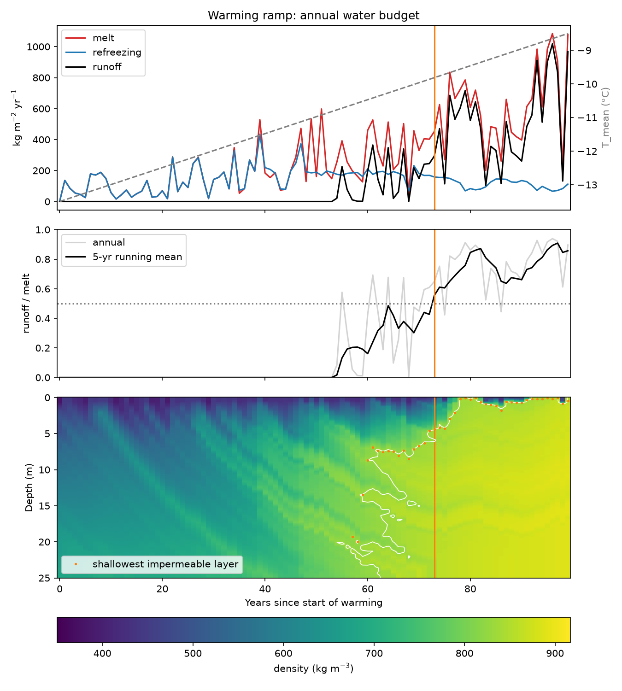
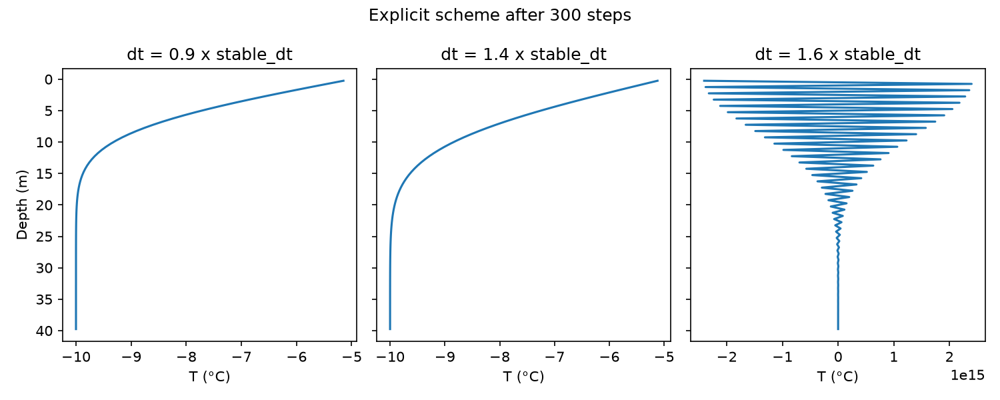
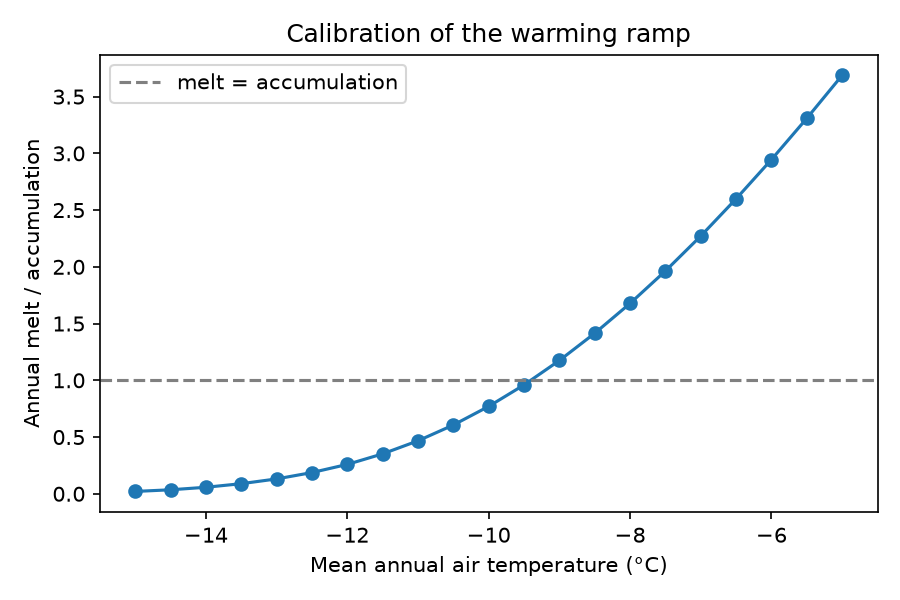
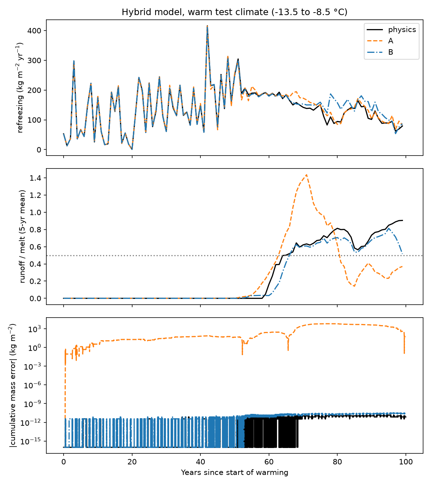
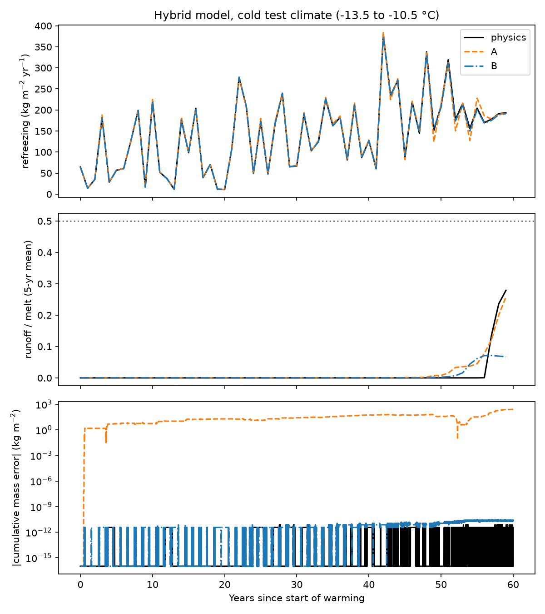

# Conservative neural emulation of a firn column near its meltwater tipping point

A small, fully reproducible study: a 1D physical model of Greenland firn that stores and refreezes
meltwater, a warming experiment in which that storage capacity collapses (an ice slab forms and runoff
takes over), and two neural emulators of the meltwater routing that differ in one thing only: whether
mass conservation is **learned** (a penalty in the loss) or **built into the architecture**
(flux-based outputs).

**Origin of the project.** The physical core is inspired by a project I carried out in *classes
préparatoires* (the French two-year intensive programme in mathematics and physics): a thermodynamic
study of firn. I rewrote and extended that model in Python, and added the machine-learning part: the
neural emulators, their training on cold climates, and their evaluation in closed loop inside the
physical model.

**Results at a glance**

- In the physical model, refreezing saturates at ~200 kg m⁻² yr⁻¹ (the winter cold content), then
  impermeable layers form at depth, migrate upward and seal the surface. After that, more than 80 % of
  the melt runs off, although porous firn remains below the slab.
- Inside the hybrid model (physics + neural hydrology), the flux-based emulator **B** conserves mass to
  machine precision (~10⁻¹¹ kg m⁻²). The penalty-based emulator **A** drifts by up to 6,500 kg m⁻² over
  100 years, about 13 years of snowfall created or destroyed.
- Out of distribution (warmer than any training climate), **B** tracks the physical model and places
  the tipping point at year 66 versus 65. **A** produces more runoff than melt, a physically
  impossible state, before collapsing.
- Conservation does not guarantee accuracy: within the training range, B underestimates the onset of
  runoff and A is better on that metric. Both results are reported below.



---

## Motivation

Greenland's porous near-surface firn currently refreezes a large part of the summer meltwater. When
refreezing fills the pores near the surface, it can create thick, low-permeability **ice slabs** that
make meltwater run off instead (Machguth et al., 2016; MacFerrin et al., 2019). Predicting when and
where firn crosses this threshold requires models that are fast enough for many climate scenarios and
that respect physical conservation laws over decades of simulation. This project is a toy version of
that problem, designed to test one concrete question:

> When a neural network replaces a physical process inside a long simulation, does it matter *how*
> conservation is enforced, and does it change the predicted tipping point?

## 1. Physical model (`firn/`)

A column of 40 Lagrangian layers (≈30 m), daily time step. Each layer carries ice mass `m_ice`,
liquid water `w` (kg m⁻²), temperature `T` (°C) and thickness `dz` (m).

| Process | Implementation |
|---|---|
| Climate forcing | Daily air temperature = annual mean (40-yr spin-up, then linear ramp) + seasonal cycle (12 °C amplitude) + interannual noise (σ = 1 °C) + daily noise (σ = 2 °C). |
| Surface melt | Positive degree-day model, melt = DDF · max(T_air, 0), with DDF = 3 kg m⁻² °C⁻¹ day⁻¹. |
| Accumulation | 500 kg m⁻² yr⁻¹ (0.5 m w.e.), within the range measured in the western Greenland percolation zone (0.33–0.69 m w.e. a⁻¹, Lewis et al., 2019). Added as one fresh-snow layer (350 kg m⁻³) each October; the bottom layer leaves the column. |
| Percolation | Tipping bucket: each layer retains water up to 4 % of its pore volume; the excess drains to the layer below. Layers denser than 830 kg m⁻³ (≈ pore close-off) are impermeable: water reaching them runs off. |
| Refreezing | r = min(w, CC/L_f, ρ_ice·dz − m_ice), with cold content CC = c_ice·m_ice·(−T). The released latent heat warms the layer: T = −(CC − L_f·r)/(c_ice·m_ice). |
| Heat conduction | ρc ∂T/∂t = ∂/∂z (k ∂T/∂z), explicit finite volumes on the non-uniform grid, harmonic-mean interface conductivity, Dirichlet surface temperature min(T_air, 0), insulated base. Substeps chosen from the stability criterion. |
| Dry compaction | Herron & Langway (1980), two stages, Arrhenius temperature dependence. |

**Mass bookkeeping.** The number of layers is fixed (the emulators need a fixed-size input). Every
operation that adds or removes a layer reports the mass it moves, so that

  Δ(column mass) = accumulation + imported − exported − runoff − drainage

can be checked at every time step. The cumulative residual over 140 years is ~10⁻¹¹ kg m⁻².

### Verification

| Test | Result |
|---|---|
| Periodic surface forcing vs. the analytic damped wave T₀ + A·e^(−z/d)·sin(ωt − z/d), d = √(2κ/ω) ≈ 3.2 m | max error 0.03 °C |
| Relaxation to a uniform surface temperature | exact to 10⁻³ °C |
| Hydrology operator alone conserves mass | to 10⁻¹⁰ kg m⁻² |
| Full 30-year run: mass budget, T ≤ 0, w ≥ 0, ρ ≤ ρ_ice | passed |

**Stability of the explicit scheme** (`scripts/stability_demo.py`). The per-layer criterion
Δt ≤ C_i·dz_i / ΣG_i is a sufficient condition, limited by the surface layer (which is only dz/2 from
the boundary): C·dz²/(3k) on a uniform grid. The scheme only blows up beyond ≈1.5 times this value,
at the von Neumann limit of the interior layers, C·dz²/(2k). The unstable mode is the expected
odd-even oscillation.



## 2. Experiment 1: warming ramp (`scripts/run_ramp.py`)

**Calibration** (`scripts/check_forcing.py`). The ramp limits were chosen so that the melt/accumulation
ratio goes from ≈0.1 to ≈1.4: a warming from −13.5 to −8.5 °C over 100 years (0.5 °C per decade).
The response is strongly convex: 5 °C of warming multiplies melt by ~15, because at cold temperatures
melt only comes from the warm tail of the weather noise.



**Tipping criterion** (fixed before running the experiments): the first year in which the 5-year
running mean of runoff/melt exceeds 0.5.

**What happens** (figure at the top, seed 0):

1. **Years 0–45: everything refreezes.** Melt and refreezing are identical; there is no runoff.
2. **From year ~45, refreezing plateaus at ~200 kg m⁻² yr⁻¹.** This is the cold content that winter
   conduction can restore: a ~15 °C gradient over ~3 m with k ≈ 0.8 W m⁻¹ K⁻¹ for ~7 months gives
   ~7.6×10⁷ J m⁻², or ~230 kg m⁻² of refreezing. Excess melt percolates deeper and the firn warms to 0 °C.
3. **Years ~55–75: impermeable layers form at depth and migrate upward**, as each summer refreezes
   water higher in the column.
4. **Tipping at year 73 (T_mean ≈ −9.8 °C); an ice slab reaches the surface by year ~78.** Refreezing
   then *drops* to ~80–100 kg m⁻² yr⁻¹ and runoff exceeds 80 % of melt. The porous firn below the slab
   no longer receives water: its storage capacity is lost although it is still porous.

The tipping point does not coincide with melt = accumulation (≈ −9.5 °C): what controls it is the
exhaustion of the cold content and the sealing of the pores.

## 3. Experiment 2: conservative vs. penalty emulators (`emulators/`)

### Design

The emulators replace only the hydrology operator (`percolate_refreeze`); heat conduction, melt,
accumulation and compaction stay physical. This is a **hybrid model**, and the emulator is called
thousands of times in closed loop.

- **Shared backbone: a minimal graph neural network on the chain of layers.** One MLP (2 hidden
  layers of 64, SiLU) is shared by all layers; for layer *i* it sees the features of layers *i−1, i,
  i+1* (density, temperature, water, thickness, refreezable mass, remaining pore space) and the water
  arriving from above. It outputs 4 numbers per layer.
- **Inference: top-down sweep.** The water passed down by layer *i* is the input of layer *i+1*, so
  water can cross the whole column in one day (a single local convolution would move it by one layer
  per step).
- **Training: teacher forcing along depth.** The true incoming flux of every layer is given, so all
  layers are computed in parallel.
- **Same physical caps for both.** Refreezing is bounded by the cold content and the pore space, and
  the temperature is updated with the same latent-heat formula.

The two heads differ in **one** thing:

| | A: penalty | B: flux |
|---|---|---|
| Outputs | 4 independent fractions of the available water (sigmoids) | softmax over refreeze / retain / runoff; the downward flux is the **remainder** |
| Mass conservation | encouraged by a penalty λ·(budget residual)² in the loss, λ = 1 | exact by construction, even with random weights (tested) |
| Parameters | 5,764 | 5,764 |

**Data.** Physical runs with 9 noise seeds on cold climates only: 40-yr spin-up, then a ramp from
−13.5 to −10.5 °C over 60 years, which stops before the tipping point. This gives 70,239 wet-day
columns for training (8 seeds) and one validation seed. The training data contain the first runoff
events and some deep impermeable layers, but no surface ice slab.

**Training.** Adam, learning rate 2×10⁻³ with cosine decay, 30 epochs, batch 256: about 2.5 minutes
on a laptop CPU. Both emulators reach the same one-step validation error (≈2.3×10⁻⁴). A's one-step
budget error is only ~10⁻⁵: **on a single step, A looks almost conservative.**

### Results in closed loop (`scripts/evaluate_emulators.py`)

Physical spin-up, then the ramp is run with the physical hydrology, with A and with B, on a new noise
seed. *Cold* = same range as training. *Warm* = full ramp to −8.5 °C, beyond the tipping point
(extrapolation).

| Climate | Model | Max mass error, 50 yr (kg m⁻²) | Max mass error, full run | Tipping year | Annual runoff RMSE (kg m⁻²) | Annual refreezing RMSE |
|---|---|---|---|---|---|---|
| cold | physics | 7×10⁻¹² | 7×10⁻¹² | none | – | – |
| cold | A | 66 | 250 | none | **27** | 7.9 |
| cold | B | 1.5×10⁻¹¹ | 3×10⁻¹¹ | none | 50 | **2.2** |
| warm | physics | 7×10⁻¹² | 2×10⁻¹¹ | 65 | – | – |
| warm | A | 77 | 6,500 | 63 | 186 | **11.4** |
| warm | B | 1×10⁻¹¹ | 3×10⁻¹¹ | **66** | **105** | 18.2 |



**Interpretation**

1. **Small per-step errors become large errors in closed loop.** A's budget error of ~10⁻⁵ per step
   accumulates over ~10⁴ calls, and each error changes the state that the network sees next. The
   training metric alone would have hidden this.
2. **Built-in conservation helps extrapolation.** In the warm climate, A's runoff fraction exceeds 1.4
   (it creates water) and then collapses. B stays on the physical trajectory and gets the tipping year
   within one year.
3. **A's tipping year (63) is right for the wrong reason.** A crosses the threshold because it creates
   water. A single metric would have been misleading.
4. **Conservation is not accuracy.** In the cold climate B underestimates the onset of runoff (5 %
   instead of 28 % in the last year), and A has the lower runoff RMSE. Conservation guarantees that
   errors do not accumulate in the budget; it does not guarantee that each flux is right.
5. **"Exact by construction" also needs numerical care.** A first version of B, computing the fluxes
   in float32, had a mass error of 4×10⁻⁴ instead of 10⁻¹¹; the fluxes are now computed in float64 at
   inference.



## Limitations

- **A toy model.** One column, no lateral flow (runoff is instantaneous), a single snow layer per year,
  a simple conductivity law, a degree-day melt model and i.i.d. daily noise. The tipping year depends
  on these choices and on the accumulation rate; it is a property of the model, not a prediction for
  Greenland.
- **One test seed per climate.** The differences between A and B are large compared with the noise,
  but a proper study would report several seeds and several training runs.
- **The emulators are slower than the physics here** (60–180 s instead of 3–5 s), because the physical
  operator is cheap and the layer-by-layer sweep in PyTorch is not optimised. The point of this study
  is the stability and conservation of an emulator in closed loop, not speed; in a real model one would
  emulate an expensive scheme.
- **Exposure bias.** Training uses the true incoming fluxes (teacher forcing), inference uses the
  network's own; training with rollouts would likely improve both emulators.

## What I would explore next

- **Controls on the tipping point:** a sensitivity study on accumulation, warming rate and noise.
- **Early-warning signals:** rolling variance and lag-1 autocorrelation of annual refreezing before
  the tipping point, and whether a threshold-driven system shows critical slowing down at all.
- **Data assimilation:** assimilate synthetic, then satellite-derived, firn density into the column
  (for example with an ensemble Kalman filter) and test whether it corrects the timing of slab
  formation.
- **From a chain to a graph:** the same conservative message passing on a spatial graph of firn
  columns with lateral water flow, driven by Destination Earth climate scenarios.

## Reproduce

```bash
conda create -n firn python=3.11 -y && conda activate firn
pip install -r requirements.txt
python -m pytest                      # 13 tests
python scripts/check_forcing.py       # calibration figures
python scripts/stability_demo.py      # stability figure
python scripts/run_ramp.py            # Experiment 1 (~5 s)
python -m emulators.train             # data + training (~3 min on CPU)
python scripts/evaluate_emulators.py  # Experiment 2 (~5 min), writes results.md
```

All random seeds are fixed. Results were identical on two different machines, apart from round-off.

## Repository structure

```
firn/
  forcing.py          climate forcing and degree-day melt
  heat.py             explicit finite-volume heat conduction and its stability criterion
  physics.py          column state, accumulation, melt, percolation/refreezing, compaction, run loop
  diagnostics.py      annual sums, runoff fraction, tipping year, ice slab depth
emulators/
  data.py             training data recorded from the physical model
  models.py           shared backbone, penalty head (A) and flux head (B)
  train.py            training on cold climates
scripts/              one script per figure or experiment
tests/                analytic, conservation and emulator tests
figures/              all figures used in this README
results.md            closed-loop results table
```

## References

- Herron, M. M. and Langway, C. C. (1980). Firn densification: an empirical model. *Journal of Glaciology*, 25(93), 373–385.
- Lewis, G. et al. (2019). Recent precipitation decrease across the western Greenland ice sheet percolation zone. *The Cryosphere*, 13, 2797.
- MacFerrin, M. et al. (2019). Rapid expansion of Greenland's low-permeability ice slabs. *Nature*, 573, 403–407.
- Machguth, H. et al. (2016). Greenland meltwater storage in firn limited by near-surface ice formation. *Nature Climate Change*, 6, 390–393.

## About this project

The physical model is inspired by a thermodynamics project on firn from my *classes préparatoires*;
the machine-learning part was added for this repository.